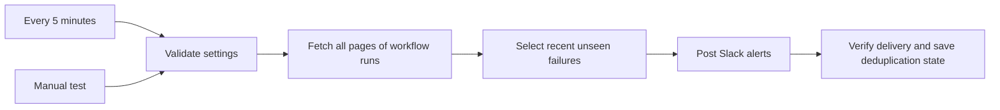

# CI Sentinel

A standalone **n8n + GitHub Actions + Slack** automation project. It checks one
GitHub.com repository every five minutes and sends a Slack message for each new
failed workflow attempt. Runs locally with Docker; no public webhook, tunnel,
paid n8n plan, AI subscription, or application changes are needed.

## How it works



- Detects `failure`, `timed_out`, and `startup_failure`; ignores successes,
  cancellations, skipped runs, and runs still in progress.
- Includes workflow, branch, actor, commit, run attempt, and a link to the run.
- Tracks repository + channel + run ID + attempt, so failed reruns can alert again.
- Escapes user-controlled text and disables Slack markdown and link previews.
- Checks Slack's `ok` field, not just its HTTP status. Delivery errors fail visibly.
- Includes a reproducible workflow generator, dependency-free tests, and GitHub CI.

## Quick start (Windows PowerShell)

### 1. Start n8n

Start Docker Desktop with Linux containers enabled. Then:

```powershell
Set-Location C:\Workspace\Projects\n8n-ci-monitor
Copy-Item .env.example .env
docker compose up -d
docker compose ps
Invoke-WebRequest http://localhost:5678/healthz/readiness
```

Open <http://localhost:5678> and create the n8n owner account. If port 5678 is
already occupied, change `N8N_PORT` in `.env` and use that port in your browser.
Only localhost is exposed; do not open the editor to the internet.

### 2. Create credentials in n8n

**GitHub API**

1. Create a fine-grained personal access token for the repository to monitor.
2. Grant repository **Actions: Read-only** access. Metadata read access is implicit.
   Obtain organization approval/SSO authorization if your organization requires it.
3. In n8n, create a **GitHub API** credential. Enter your GitHub username and token;
   leave the server as `https://api.github.com`.

**Slack API**

1. Create a Slack app at <https://api.slack.com/apps>.
2. Under **OAuth & Permissions**, add the bot scope **`chat:write`**.
3. Install the app into your workspace (or reinstall it after changing scopes).
4. Copy the **Bot User OAuth Token** into an n8n **Slack API** credential.
5. Invite the bot to the destination channel, including private channels.
6. Copy the channel ID from Slack's channel details; use the ID, not `#channel-name`.

Do not paste tokens into workflow nodes, source files, screenshots, or GitHub.
The HTTP nodes use n8n's built-in credential types. If a bot-only Slack credential
test reports a profile-scope error, test the workflow operation itself: this project
uses `chat.postMessage`, which requires `chat:write`, not profile-reading scopes.

### 3. Import and configure the workflow

If **CI Sentinel - GitHub Actions to Slack** is already present in your local
instance, open it and skip the import steps. Reimporting creates a separate
workflow with separate delivery state.

1. In n8n, create a workflow and choose **Import from File**.
2. Import [`workflows/ci-monitor.json`](workflows/ci-monitor.json).
3. Open **Monitor settings** and replace:

   | Field | Value |
   | --- | --- |
   | `owner` | GitHub user or organization that owns the monitored repository |
   | `repo` | Repository name only, for example `techworld-with-nana-java-app` |
   | `channel` | Slack channel ID |
   | `lookbackHours` | Recent update window, default `24`; supported range `1` to `168` |

4. In **Fetch workflow runs**, select your GitHub API credential.
5. In **Send Slack alert**, select your Slack API credential.
6. Save. Execute manually once. **This sends real Slack messages** for failures
   updated within the lookback window. If none exist, it stops after selection.
7. Publish/activate the workflow so the schedule runs. Keep Docker and your
   computer running; sleeping or shutting down the computer stops monitoring.

**Verify live behavior:** use an existing recent failure, or deliberately fail a
workflow in a disposable test repository. Confirm its run link appears in Slack.
Let two scheduled executions finish: the second should not repeat a delivered
attempt. Rerun the failed GitHub workflow and confirm a new failed attempt alerts.
Do not introduce a failing commit into a production repository just to test this.

## Delivery guarantees and limits

- **Polling, not real-time:** typically up to five minutes plus execution time.
  The first execution includes failures updated in the lookback window.
- The GitHub endpoint is paginated without a `created` or `status` filter. This
  deliberately includes recently updated reruns of older workflows and avoids
  the filtered search result cap. Every poll scans the retained run history.
  Approximate requests per hour: `12 * (floor(total_runs / 100) + 1)`, before retries.
  This starter is intended for small/medium repositories; large histories need a
  webhook-based design or a longer schedule to stay within rate/resource limits.
- GitHub pagination is not a snapshot: new runs arriving during a scan can move
  page boundaries. Duplicate rows are removed; a later poll can catch missed rows.
  Only each run's latest attempt is available from this endpoint. Intermediate
  attempts that finish and are rerun between polls may not be observed.
- The window uses `updated_at`, not run creation time. An outage longer than the
  configured window can miss failures. Increasing the window can replay older
  alerts whose delivery records have already been pruned.
- Deduplication uses n8n **workflow static data**, an experimental n8n feature
  persisted only after a successful **scheduled/production** execution.
  **Manual executions do not persist it** and can repeat messages. Do not run
  manual tests concurrently with the active schedule. The supplied Compose
  configuration serializes production executions to reduce state races.
- Alerts are acknowledged only if **every** Slack request is confirmed. Partial
  delivery, a timeout after Slack accepts a message, or a crash before saving can
  produce duplicates on the next poll. This is retry-oriented, **not exactly-once**
  delivery. HTTP/Slack errors remain failed n8n executions; they are not hidden.
- Slack requests are spaced about 1.1 seconds apart. Execution timeout is four
  minutes. Large failure bursts can exceed it and replay partially sent batches.
  For high-volume use, replace static data with a durable per-alert outbox and
  independently committed acknowledgements.
- GitHub read requests retry up to three times. Slack sends are not automatically
  retried within a node, because a timeout may occur after delivery. The next poll
  retries unacknowledged alerts that remain within the window.
- Old delivery markers are pruned on the next successful delivery. If there are
  no new alerts, existing state remains unchanged.
- This workflow does not independently alert if n8n itself is offline. Check
  **Executions**, container health, and logs; use an external uptime monitor for
  production monitoring.

## Local operations

```powershell
docker compose logs --tail 100 n8n
docker compose restart n8n
docker compose stop
docker compose start
```

Workflow data, credentials, SQLite data, and the automatically generated encryption
key persist together in the `n8n_data` named volume. Back up that volume while n8n
is stopped; keep backups private and test restoration. Never use `down -v` unless
you intend to erase it. Losing the encryption key makes stored credentials unusable.
Successful and failed execution data is retained for up to seven days / 1,000
executions and may contain private repository metadata.

The image is pinned to n8n `2.45.7`. Review release/security notes and test workflow
compatibility before upgrading the tag in `compose.yaml`. This is a local,
single-user setup using n8n's default internal JavaScript runner. For a shared or
internet-facing deployment, use external task runners, HTTPS, a reverse proxy,
proper backups, and a separate production hardening review.

### Troubleshooting

| Symptom | Check |
| --- | --- |
| Docker named-pipe/daemon error | Start Docker Desktop and select Linux containers. |
| GitHub 401/403/404 | Token validity, selected repository, Actions read access, organization approval, rate limit. |
| Slack `not_in_channel` / `channel_not_found` | Invite the bot and check the channel ID/workspace. |
| Slack `missing_scope` / `invalid_auth` | Add `chat:write`, reinstall the app, and update the credential. |
| No scheduled runs | Publish/activate the workflow; keep Docker and the computer awake. |
| No alerts | Confirm a supported completed failure was updated within `lookbackHours`. |
| Repeated alerts | Manual test, failed/partial delivery, changed channel/window, lost static data, or reimported workflow. |
| Timeout / rate limiting | Inspect failed executions; reduce poll frequency or adopt webhook/outbox architecture. |

## Develop and validate

Node.js 22+ is needed only for development, not for running n8n with Docker.
There are no npm dependencies and no installation step.

```powershell
npm run build
npm run validate
docker compose --env-file .env.example config --quiet
```

Edit [`src/monitor.mjs`](src/monitor.mjs) for filtering/message/state logic and
[`scripts/build-workflow.mjs`](scripts/build-workflow.mjs) for node configuration.
Rebuild and commit the generated workflow with source changes. The build is
deterministic; CI fails if the exported JSON is stale.

Tests execute both the pure logic and the **actual generated Code node bodies**
with mocked n8n inputs. They cover pagination expressions, response validation,
lookback boundaries, retries by run attempt, duplicate pages, Slack escaping,
partial delivery, and state pruning. They do **not** replace a real n8n import,
scheduled persistence test, or credentialed GitHub/Slack integration test.

## Publish as a GitHub portfolio project

Create an empty GitHub repository named `n8n-ci-monitor`. Then, from this folder:

```powershell
git init -b main
git add .
git diff --cached --stat
git commit -m "Add n8n CI monitoring project"
git remote add origin https://github.com/YOUR-USERNAME/n8n-ci-monitor.git
git push -u origin main
```

Before committing, inspect staged files for secrets. `.env` and backups are
ignored. Never commit a credential export. Suggested repository topics:
`n8n`, `github-actions`, `slack`, `docker`, `devops`, `automation`.
Add a redacted workflow screenshot and sample alert after your live test.

## References

- [n8n Docker installation](https://docs.n8n.io/hosting/installation/docker/)
- [n8n static data behavior](https://docs.n8n.io/code/cookbook/builtin/get-workflow-static-data/)
- [n8n concurrency control](https://docs.n8n.io/hosting/scaling/concurrency-control/)
- [GitHub workflow runs API](https://docs.github.com/en/rest/actions/workflow-runs)
- [Slack chat.postMessage](https://docs.slack.dev/reference/methods/chat.postMessage/)
